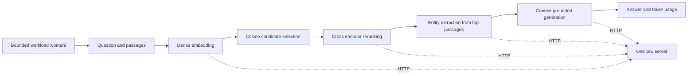

# Multi Model Inference Pipeline

Run an embedder, reranker, entity extractor, and generator through one
[Superlinked Inference Engine (SIE)](https://github.com/superlinked/sie) server.
The example answers a fictional invoice question by selecting evidence, ranking
passages, extracting labeled spans, and generating an answer from that context.
One client handles the four different result types.

The default mode is an offline HTTP contract replay. It starts a temporary
localhost fixture service, uses the same HTTP client as live mode, and shuts the
service down on exit. Its vectors, scores, spans, answer, and token counts are
synthetic test data. This mode tests application behavior without downloading
weights or allocating a GPU. Live mode calls an existing SIE server.

## Architecture



The application sends four sequential inference calls per workflow. Multiple
workflows run concurrently, so the server receives interleaved model requests.
SIE owns model loading, memory management, and batching; this project implements
the client and workload, rather than duplicating the inference engine.

## CODE MAP

| File | Responsibility |
| --- | --- |
| `main.py` | CLI, replay/live selection, readiness check, JSON report and exit status. |
| `inference/__init__.py` | Package marker and overview. |
| `inference/client.py` | Exact native SIE JSON routes, response validation, model-loading retries, HTTP counters. |
| `inference/workflow.py` | Fixture loading, scale-safe cosine selection, four-stage workflow, mixed benchmark operations. |
| `inference/workload.py` | Fixed worker pool, exact operation allocation, success/failure counts and latency percentiles. |
| `inference/replay.py` | Temporary localhost HTTP service that checks requests and serves synthetic contract responses. |
| `fixtures/invoice.json` | Fictional evidence, hand-authored vector heads, relevance scores, entity labels and expected answer. |
| `tests/__init__.py` | Test package marker. |
| `tests/test_pipeline.py` | HTTP contracts, sequencing, failures, bounded concurrency, malformed responses, and CLI integration. |
| `requirements.txt` | Documents the standard-library-only runtime and test dependencies. |

## Run offline

Requires Python 3.10 or newer. No additional packages are needed.

```powershell
python -B main.py demo --requests 4 --concurrency 2
python -B main.py benchmark --requests 2700 --concurrency 32 --output results/replay.json
python -B -m unittest discover -s tests -v
```

`demo --requests N` runs N complete workflows, normally producing 4N inference
calls. It uses both the issuer and payment passages so the amount is preserved.
`benchmark --requests N` sends exactly N independent inference operations,
cycling across encode, score, extract, and generate. At 2,700 operations, each
task receives 675 calls. Default workload size is 16 with four workers.

The JSON report includes operation success/failure totals, actual maximum
concurrency, completed operations per second, and nearest-rank p50/p95 latency.
HTTP counters separately expose attempts, successful HTTP statuses, HTTP error
responses, transport failures, and loading retries. The readiness GET is excluded
from inference counters. A retry increases HTTP attempts without increasing the
requested operation count. The CLI exits nonzero if any operation fails.

Only a fixed number of worker futures are allocated; the workload does not
submit thousands of pending futures. It retains three sample results and latency
measurements for all operations. Metrics from replay are local fixture timings,
not GPU throughput, model quality, utilization, cost savings, or an independent
reproduction of a hardware benchmark.

## Connect to SIE

Start or obtain access to an existing SIE server using the
[upstream quickstart](https://github.com/superlinked/sie#quickstart). This client
does not install the server, download models, or deploy infrastructure.

```powershell
python -B main.py demo --mode live --url http://127.0.0.1:8080 --requests 1 --concurrency 1
python -B main.py benchmark --mode live --url http://127.0.0.1:8080 --requests 2700 --concurrency 32 --output results/live.json
```

For an authenticated server, set `SIE_API_KEY` in the environment; the client
sends it as a bearer credential and never prints it. Use HTTPS outside the
loopback interface. Redirects are rejected and environment proxies are not used.
The client accepts JSON responses up to 2 MiB. It does not expose a public replay
server or follow server-provided URLs.

| Stage | Default model | Native route |
| --- | --- | --- |
| Embed | `sentence-transformers/all-MiniLM-L6-v2` | `/v1/encode/sentence-transformers/all-MiniLM-L6-v2` |
| Rerank | `cross-encoder/ms-marco-MiniLM-L-6-v2` | `/v1/score/cross-encoder/ms-marco-MiniLM-L-6-v2` |
| Extract | `urchade/gliner_multi-v2.1` | `/v1/extract/urchade/gliner_multi-v2.1` |
| Generate | `Qwen/Qwen3-0.6B` | `/v1/generate/Qwen__Qwen3-0.6B` |

JSON embeddings arrive as `items[].dense = {dims, dtype, values}`; values are
lists, rather than the numpy arrays returned by the official Python SDK.
Extraction labels belong under `params.labels`. Generation replaces the model
ID's slash with `__` in the path. Models can be overridden using `--embedder`,
`--reranker`, `--extractor`, and `--generator` in live mode. Alternate models must
support the same tasks and response shapes.

At the inspected upstream revision, the first three families have CPU paths.
The generation model uses an SGLang adapter and requires a supported NVIDIA GPU
server, CUDA stack, and sufficient memory; a CPU-only server cannot run the full
workflow. The SIE server itself requires Python 3.12 in its native installation.
Windows can run this client and replay; server platform support follows upstream.
The default model catalog limits are 256 embedding input tokens, 512 reranker
sequence tokens, 384 extraction input tokens, and a 4,096-token generation
context with at most 1,024 output tokens. This client requests 64 output tokens.
These are catalog limits, not GPU memory guarantees. Long inputs may be truncated
by the server. Start small and measure actual server memory before increasing
concurrency. No live model or GPU execution is claimed by offline tests.

Explicit `503 MODEL_LOADING` responses are retried up to `--loading-retries`
(default 60) with one second between retries. Every HTTP attempt has a
`--timeout` of 120 seconds by default. Other errors, malformed results, per-item
failures, and transport/read timeouts fail the operation. Generation is never
silently repeated after a timeout. Missing generation usage remains `null`;
reported usage must have valid nonnegative counts. Scores are logits, not
probabilities. This example checks contracts and orchestration, not answer
accuracy on arbitrary invoices.

## Source contracts

The HTTP shapes and catalog were checked against upstream commit
[`b94c1938dc9f3dc4a687243cbd32f97c9492355a`](https://github.com/superlinked/sie/tree/b94c1938dc9f3dc4a687243cbd32f97c9492355a)
(server package version `0.10.1`):

- [Request types](https://github.com/superlinked/sie/blob/b94c1938dc9f3dc4a687243cbd32f97c9492355a/packages/sie_server/src/sie_server/types/requests.py),
  [response types](https://github.com/superlinked/sie/blob/b94c1938dc9f3dc4a687243cbd32f97c9492355a/packages/sie_server/src/sie_server/types/responses.py),
  and [dense-vector envelope](https://github.com/superlinked/sie/blob/b94c1938dc9f3dc4a687243cbd32f97c9492355a/packages/sie_server/src/sie_server/types/outputs.py).
- [Official SDK route construction](https://github.com/superlinked/sie/blob/b94c1938dc9f3dc4a687243cbd32f97c9492355a/packages/sie_sdk/src/sie_sdk/client/sync.py)
  and [model catalog](https://github.com/superlinked/sie/tree/b94c1938dc9f3dc4a687243cbd32f97c9492355a/packages/sie_server/models).
